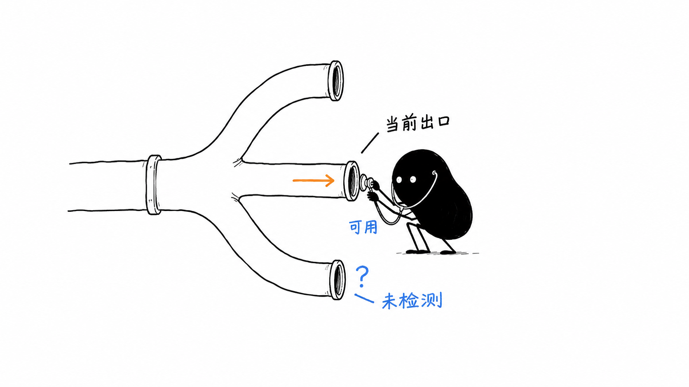

# Mihomo Monitor · Mihomo 监控

**看清出口、追踪连接、了解订阅节点状态的独立 Mihomo 监控面板。**

Mihomo Monitor 通过 Mihomo Controller 汇总代理组、活动连接和 Proxy Provider 信息，帮助你排查「请求走了哪个出口」以及「节点状态为什么不一致」。可以独立访问，也可以通过可选的 CPA 菜单入口打开；默认只读，按需授权手动切换代理组。

[中文使用指南](docs/USER_GUIDE.md) · [下载 v0.2.4](https://github.com/deepfry666/cpa-mihomo-monitor/releases/tag/v0.2.4) · [部署要点](#部署要点) · [从源码构建](#从源码构建)



*上图为出口状态概念插图，不是界面截图；页面读取 Controller 已有的健康结果，不主动测速。*

## 从这里开始

| 你想做什么 | 阅读入口 |
| --- | --- |
| 先了解能看到哪些信息 | [功能一览](#能做什么)与[状态解读](docs/USER_GUIDE.md#怎样读懂状态) |
| 第一次部署独立面板 | [安装与部署](docs/USER_GUIDE.md#安装与部署)与[配置参考](docs/USER_GUIDE.md#配置参考) |
| 在 CPA 中添加菜单 | [两个发布物](#两个发布物分别升级)与[安装 CPA 菜单入口](docs/USER_GUIDE.md#安装-cpa-菜单入口) |
| 已安装，需要升级或排错 | [升级与回退](docs/USER_GUIDE.md#升级与回退)与[常见问题](docs/USER_GUIDE.md#常见问题) |

## 能做什么

- 看出口：显示代理组、实际出口、转发链路，以及 Controller 提供的健康状态和最近检测信息。
- 查连接：查看主机、进程、规则、链路、流量与连接时间，支持搜索、排序和详情查看。
- 看订阅：汇总每个 Provider 的节点总数、可用数、异常数和未检测数。
- 换出口：对明确允许的手动选择组进行确认后切换，并读回当前选择核对结果。
- 独立登录：使用管理密钥建立 12 小时会话，支持自动刷新、暂停刷新、亮暗主题和手机布局。

### 使用边界

- **状态是观察结果，不是连通保证。** 代理组状态跟随最终选中的出口，区分「可用」「异常」「未检测」；缺少检测结果时保留未知。页面不主动发起节点测速，也不负责自动故障切换。
- **默认不允许切换。** 只有列入 `MIHOMO_MONITOR_SELECTABLE_GROUPS`、类型为 `Selector` 且至少有两个候选的组才开放操作。切换不会主动断开已有连接。
- **面向当前状态排查。** 连接明细最多显示 200 条，每个 Provider 最多显示 500 个节点明细；搜索范围限于已取得的连接。累计流量不是持久化历史报表。
- **不替代 Mihomo 配置管理。** 订阅更新策略、规则和节点健康检查仍由 Mihomo 的配置或其他管理工具维护。

## 工作方式


浏览器访问监控服务，由服务连接内部网络中的 Controller；监控登录密钥与 Controller secret 分开配置。CPA 插件仅提供入口，**安装 `.so` 不会启动监控服务**。反向代理、内部网络及面板自动登录适配需由部署环境配置。

## 两个发布物，分别升级

| 发布物 | 当前版本 | 职责 |
| --- | --- | --- |
| `mihomo-monitor-server` | `0.2.4` | 提供监控页面、采集数据、登录会话和代理组切换 |
| `mihomo-monitor-v0.2.3.so` | `0.2.3` | 在 CPA 中注册一个「Mihomo 监控」菜单入口 |

监控服务直接连接 Mihomo Controller，不依赖 CPA 或 CPAMP 的内部接口。CPA 入口插件使用 ABI v1，只负责将菜单页重定向到 `/mihomo-monitor/dashboard`。其他面板也可以增加指向该地址的入口；iframe 自动登录和主题传递需要相应的面板适配。

## 部署要点

1. 下载 [v0.2.4 Release](https://github.com/deepfry666/cpa-mihomo-monitor/releases/tag/v0.2.4) 中的服务二进制、入口插件与 `SHA256SUMS`，核对所需产物。当前这两份预构建程序均为 Linux amd64；服务二进制放到 `dist/mihomo-monitor-server` 后，可使用仓库的 [Dockerfile](Dockerfile) 构建镜像。
2. 将监控服务接入 Mihomo 所在的内部网络，挂载管理密钥文件及 Controller secret 文件。通过 HTTPS 反向代理把 `/mihomo-monitor/` 原样转发到监控服务的 `18319` 端口。
3. 如需 CPA 菜单，将 `mihomo-monitor-v0.2.3.so` 放入 CPA 的 `plugins/linux/amd64/`，启用插件 ID `mihomo-monitor`，并将其配置的 `store.version` 设为 `0.2.3`。
4. 打开 `/mihomo-monitor/dashboard` 登录，检查 Controller 状态、数据更新时间和代理组。需要手动切换时，再配置允许操作的组。

| 环境变量 | 用途 |
| --- | --- |
| `MIHOMO_MONITOR_ADMIN_KEY_FILE` | 监控页面的管理密钥文件，需可读且非空 |
| `MIHOMO_MONITOR_SECRET_FILE` | Mihomo Controller 的 secret 文件；Controller 启用鉴权时设置 |
| `MIHOMO_MONITOR_CONTROLLER_URL` | Controller 地址，默认 `http://mihomo:9090` |
| `MIHOMO_MONITOR_SELECTABLE_GROUPS` | 允许手动选择的组名，逗号分隔；默认全部只读 |

登录会话采用 HttpOnly、Secure、SameSite=Strict Cookie，浏览器访问入口应使用 HTTPS。生产环境应通过内部网络连接 Controller 和监控服务；密钥文件不进入仓库。详细安装示例、旧配置兼容项与升级检查见[指南](docs/USER_GUIDE.md)。

## 从源码构建

需要 Go 1.22 或更新版本。以下命令构建 Linux amd64 发布物；共享库还需要 Linux amd64 的 C 工具链。在其他系统交叉编译入口插件时，需要另行配置匹配目标平台的 `CC`。

```sh
CGO_ENABLED=0 GOOS=linux GOARCH=amd64 go build -trimpath -ldflags="-s -w" -o dist/mihomo-monitor-server ./cmd/server
CGO_ENABLED=1 GOOS=linux GOARCH=amd64 go build -buildmode=c-shared -trimpath -ldflags="-s -w" -o dist/mihomo-monitor-v0.2.3.so ./cmd/plugin
```

源码验证命令：

```sh
go test -count=1 ./...
go vet ./...
```

构建镜像：

```sh
docker build -t mihomo-monitor:0.2.4 .
```

镜像以非 root 用户 `65532:65532` 运行，挂载的密钥文件需要允许该用户读取。仓库包含本模块源码与构建文件；生产 Compose、运行数据、密钥及定制面板由各部署环境单独维护。

## 0.2.4 发布说明

此版本对应独立监控服务，CPA 菜单入口保持 `0.2.3`。

- 代理组健康状态跟随实际出口，区分健康、故障和未知。
- Provider 提供节点状态和健康数量，连接列表注明明细裁剪情况。
- 仪表盘保留独立登录、出口选择、亮暗主题及键盘可访问的标签页。
- Release 附带 `SHA256SUMS`，可用于核对下载产物。

升级服务与升级入口插件是两件事。下载新文件后应按目标版本部署；入口插件需显式设置对应版本，避免直接覆盖正在加载的 `.so`。具体步骤见[升级说明](docs/USER_GUIDE.md#升级与回退)。
